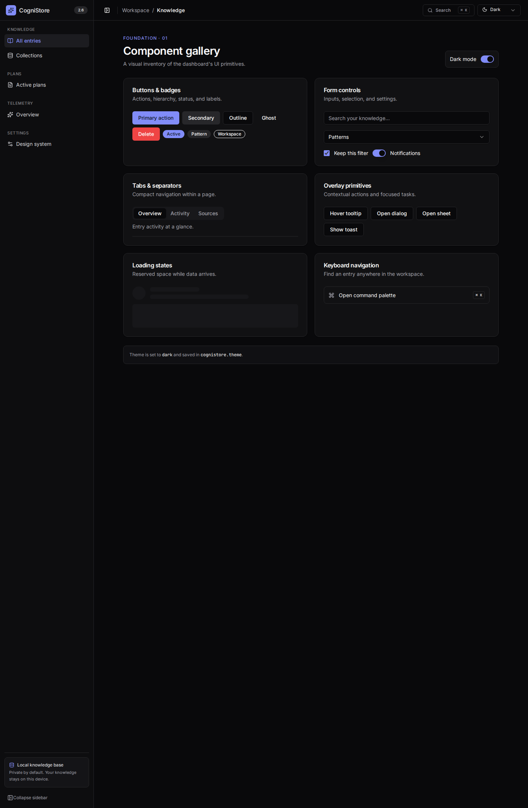
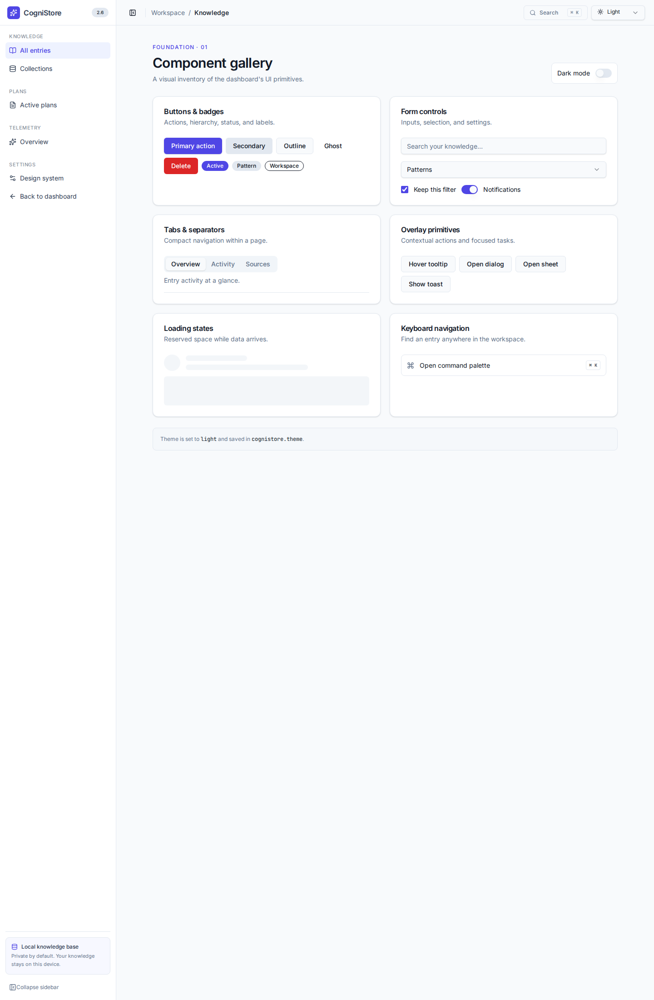
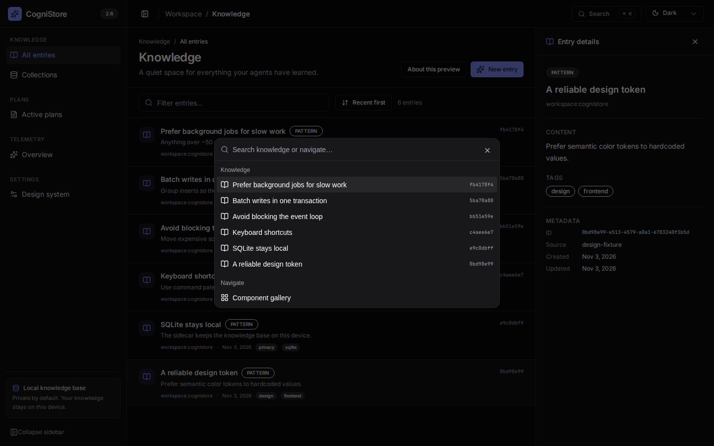

# Rodada 7 — Estabilidade e base da nova UI (2026-11-03)

Branch base: `release/2.6`. Cada grupo foi feito num branch `plan/<item>-<slug>` e entrou com `merge --no-ff` depois de `pnpm verify --coverage` verde. Nada foi publicado; sem bump, tag ou merge em `main`.

## Resumo

| Item | Merge | Resultado |
|---|---|---|
| Revisão do gerente da Rodada 6 (plano) | e6ee2ec | commitado primeiro |
| B.12 limites de event loop/drift dos @perf | 814800a | entregue |
| B.13 MCP sem compilador + better-sqlite3 sem build | 3f805c0 | entregue |
| U.0.2 spike shadcn/ui + U.1 sistema de design | 0a216be | entregue (um branch só: os dois são acoplados) |

## B.12 — `PERF_BUDGET_SCALE` em todos os limites de event loop e drift

Todos os limites de event loop, drift, p99 e máximo do loop principal dos @perf passaram por `scaledLimit()`: `duplicates-eventloop` (incluindo o dense cluster, que falhou no CI com 123,9 ms), `export-eventloop` e os testes de worker. Os valores base não mudaram (100 ms; 50 ms na exportação).

Mediana de 3 execuções locais com `PERF=1 PERF_BUDGET_SCALE=3` (ms):

| Caso / medição | Exec. 1 | Exec. 2 | Exec. 3 | Mediana |
|---|---:|---:|---:|---:|
| Duplicatas full: monitor máx. | 15,6 | 15,7 | 21,4 | 15,7 |
| Duplicatas full: drift máx. | 14,9 | 13,0 | 16,4 | 14,9 |
| Duplicatas incremental: monitor máx. | 16,2 | 14,1 | 15,9 | 15,9 |
| Duplicatas incremental: drift máx. | 13,3 | 12,1 | 13,0 | 13,0 |
| Dense cluster: monitor máx. | 20,0 | 23,8 | 21,7 | 21,7 |
| Dense cluster: drift máx. | 47,6 | 47,6 | 50,6 | 47,6 |
| Exportação: monitor máx. / p99 | 4,3 | 5,2 | 7,8 | 5,2 |
| Reembed worker: loop principal máx. | 19,7 | 30,1 | 30,9 | 30,1 |
| Reembed worker: drift máx. | 65,4 | 26,1 | 27,1 | 27,1 |
| Duplicatas worker: loop principal máx. | 22,9 | 29,4 | 25,9 | 25,9 |
| Duplicatas worker: drift máx. | 19,6 | 26,0 | 23,2 | 23,2 |

As três execuções passaram 21/21. **Atenção:** os @perf só rodam com `PERF=1`; sem isso o comando `--grep @perf` não encontra nada.

## B.13 — MCP sem compilador

- **(a) Job `mcp-npx-no-toolchain`** (`.github/workflows/ci.yml`, script `scripts/ci/mcp-npx-smoke.sh`): compila o pacote do MCP, faz `npm pack`, instala o tarball numa `node:24-slim` **sem** python, make e g++ (o script confirma que os três não existem) e chama as 4 ferramentas. Rodei o script localmente com Docker: passou (101 pacotes instalados, 4 ferramentas OK). O job em si ainda não rodou no CI.
- **(b) `pnpm.neverBuiltDependencies: ["better-sqlite3"]`:** o pnpm não executa mais `node-gyp` para ele. `CI=true pnpm install --frozen-lockfile` passa e `better-sqlite3` abre `:memory:` (SQLite 3.53.4).
- **Bundle do sidecar:** o `bundle-sidecar.mjs` copia só `prebuilds/<plataforma>-<arch>.node` e não recompila mais a partir do código-fonte. Antes eram 8 binários (~16,9 MB); agora o bundle linux-x64 leva só `linux-x64.node` (2.226.168 bytes). O smoke do bundle (health, busca semântica com sqlite-vec, job no worker) passou.

## U.0.2 + U.1 — shadcn/ui e sistema de design

### O que foi entregue

- Atalho escondido Ctrl/Cmd+Shift+D abre `/_design`, e o link "Back to dashboard" retorna ao app legado.

- **shadcn/ui** inicializado em `apps/dashboard` (`components.json`, alias `@/`, Tailwind v4). Componentes copiados para `src/components/ui/`: badge, button, card, checkbox, command, dialog, dropdown-menu, input, popover, scroll-area, select, separator, sheet, sidebar, skeleton, sonner, switch, tabs, tooltip. **Licença MIT** (shadcn/ui) registrada em `src/components/ui/LICENSE-shadcn.md` e no `PATCH-NOTES.md`.
- **Rota `/_design`** (carregada sob demanda, fora do menu e **fora** do layout antigo):
  - `/_design` — tela de prova: sidebar agrupada recolhível, paleta ⌘K / Ctrl+K (cmdk), lista densa com dados reais da API, painel de detalhe lateral roteado (`/_design/k/:id`), toast, dialog e select.
  - `/_design/gallery` — todos os primitivos, com alternância de tema.
- **Tokens semânticos** no `@theme` do Tailwind v4 (`src/design/theme.css`), temas claro, escuro e "seguir o sistema", **dark como padrão**, salvo em `localStorage` (`cognistore.theme`). Sem flash: `public/theme-init.js` roda antes do React.
- **Ícones lucide**, **Inter** e **JetBrains Mono** auto-hospedadas via `@fontsource` (o Tauri funciona offline). As telas atuais **não foram migradas** (Rodada 8): continuam com emojis e estilos próprios.

### Orçamento do bundle inicial (arquivos de `index.html`)

| | Antes (`release/2.6`) | Depois | Variação |
|---|---:|---:|---:|
| JS + CSS, bytes brutos | 1.232.896 | 1.316.888 | **+6,8%** |
| JS + CSS, gzip | 339.630 | 369.171 | **+8,7%** |

Dentro do limite de 30%. A rota `/_design` é um chunk separado; o aumento vem do CSS do tema e das fontes.

### Resultado do spike no WebKitGTK

**O que foi testado:** o WebKitGTK real do sistema (libwebkit2gtk-4.1 2.52.6, o mesmo motor do webview do Tauri no Linux), dirigido por `WebKitWebDriver` + `MiniBrowser`, contra um sidecar temporário (`packages/tests/scripts/webkitgtk-probe.ts`). **O que não foi testado:** o binário do Tauri em si. O app não foi iniciado (Origin pinning e token do shell, e o Rust local é 1.89 contra 1.90 exigido), então janela, atalhos do sistema e `tauri://` ficam para o build de pré-release. O WebKit do Playwright também não foi usado, porque pede `sudo` para instalar dependências.

| Verificação | Resultado |
|---|---|
| Galeria renderiza | ✅ |
| Alternar tema claro/escuro | ✅ |
| `backdrop-filter` e `-webkit-backdrop-filter` | ✅ ambos suportados |
| Select abre, escolhe, fecha e devolve o foco | ✅ |
| Dialog fecha com Esc e devolve o foco ao botão | ✅ |
| Toast aparece | ✅ |
| Lista → painel de detalhe roteado (`/_design/k/<id>`) | ✅ |
| Paleta ⌘K abre, filtra e navega | ✅ |
| Anel de foco do campo de filtro (`box-shadow` muda no foco) | ✅ |

Os 10 resultados estão em `assets/rodada-7/webkitgtk-results.json`.

**O que precisou de ajuste.** Nada foi específico do WebKitGTK; todos os defeitos apareciam também no Chromium e foram achados olhando os screenshots:

1. O script inline de tema era bloqueado pela CSP (`script-src 'self'`) do sidecar e do Tauri; virou o arquivo externo `public/theme-init.js`.
2. O `@theme` estava num CSS importado separadamente do `@import "tailwindcss"`, então o Tailwind não gerava `bg-card`/`bg-popover` e a paleta ficava transparente; o import passou para `styles.css`. As telas antigas não usam esses nomes de utilitário (usam variáveis `--bg-*` e estilos inline).
3. `CommandDialog` era o componente cru do cmdk; virou o wrapper do shadcn (Dialog + Command).
4. O painel de detalhe nunca carregava: o `id` vinha de `useParams()` num componente sob a rota `/_design/*`, que só tem o parâmetro splat.
5. O Select do Radix tem papel `combobox`, não `button`.

### Checklist para o macOS (o mantenedor confere no build de pré-release)

- [ ] Ctrl/Cmd+Shift+D abre o /_design (atalho escondido, sem item de menu); o item "Back to dashboard" volta ao app
- [ ] ⌘K (e não Ctrl+K) abre a paleta; Esc fecha; setas e Enter navegam.
- [ ] Select e dropdown: abrir, rolar, escolher por teclado; o foco volta ao gatilho.
- [ ] `backdrop-filter` (blur) nos overlays de dialog, sheet e paleta; sem artefatos nem queda de FPS.
- [ ] Anel de foco visível ao navegar com Tab (campo de filtro, botões, switch).
- [ ] Fontes Inter e JetBrains Mono carregam offline (sem rede) no app empacotado.
- [ ] Alternar claro/escuro/sistema; mudar o tema do macOS com "sistema" ativo atualiza ao vivo.
- [ ] Rolagem interna da lista e do painel (inércia, barras), sem rolagem da página inteira.
- [ ] Toast aparece no canto e some sozinho.
- [ ] As telas antigas continuam idênticas (Home, Planos, Tokens, Provedores, Estatísticas, Configurações).

### Screenshots

Chromium (`documentation/plans/reports/assets/rodada-7/`):

- `design-dark.png`, `design-light.png` — galeria nos dois temas.
- `proof-list-panel-palette.png` — lista + painel de detalhe + ⌘K aberta.

WebKitGTK real, mesmos três com sufixo `-webkitgtk`: `design-dark-webkitgtk.png`, `design-light-webkitgtk.png`, `proof-list-panel-palette-webkitgtk.png`.

## Observações e decisões em aberto

- **Deep link 403 (já conhecido):** abrir direto uma rota que não seja `/` (por exemplo `/_design`) devolve `{"error":"Forbidden"}` do sidecar; só a navegação dentro do app funciona. Isso vale para qualquer rota do app e não foi alterado (é fronteira de autenticação). Os testes e os scripts carregam `/` e navegam no cliente. **Decisão:** tratar na Rodada 8, quando as telas ganharem URL própria (U.2)?
- **Instabilidade pontual:** numa de 4 execuções do `pnpm verify`, o `beforeAll` do teste `design-route` não viu o sidecar subir em 45 s (`waitForSidecar` falso); passou nas três seguintes. Proposta **B.14:** `stdio` do sidecar capturado nesse teste para diagnosticar, e reaproveitar o helper `spawnSidecar`.
- **Dependências novas** (todas MIT, só no dashboard): radix-ui (dialog, checkbox, dropdown-menu, popover, select, separator, slot, switch, tabs, tooltip), cmdk, sonner, lucide-react, class-variance-authority, clsx, tailwind-merge, @fontsource-variable/inter e @fontsource/jetbrains-mono.
- **Arquivos soltos fora desta rodada** (não commitados): `documentation/agent-kit/skills/cognistore-manager/` e `documentation/plans/AUTONOMOUS-PROMPT.md`.
- O `biome.json` ganhou `css.parser.tailwindDirectives` (o linter não lia `@theme`).

## CI do PR #109

Run `41674233899` no commit `5835ccc` (HEAD de `release/2.6`).

| Job | Resultado |
|---|---|
| build-and-test | ✅ |
| type-check | ✅ |
| rust | ✅ |
| sidecar-bundle | ✅ |
| perf | ✅ |
| mcp-npx-no-toolchain (novo, B.13) | ✅ primeira execução no CI |
| osv-scan | ✅ (ver abaixo) |
| validate-dependencies | ✅ na 2ª execução (ver abaixo) |
| version-check | ❌ esperado: "Version not bumped" (2.5.4 = main) |
| release-version-guard | ❌ esperado: mesma regra |

- **osv-scan:** falhou no commit anterior (`d5e9969`) por `lodash 4.18.0` (GHSA-f23m-r3pf-42rh, severidade média, prototype pollution em `_.unset`/`_.omit`/`_.pullAt`). É dependência transitiva de `recharts`, já presente antes da Rodada 7; o advisory é que é novo no banco do OSV. Correção: override `lodash >=4.18.1` no `package.json` raiz (lockfile resolve 4.18.1), commit `2ef7dd9`, merge `5835ccc`.
- **validate-dependencies:** a primeira execução recebeu HTTP 403 da GitHub Releases API (limite de requisições sem autenticação), não relacionado à mudança; reexecutado só esse job e passou.
- **version-check e release-version-guard:** vermelhos de propósito. A regra do projeto é não fazer bump até o release; ficam verdes só no bump da Fase R. No commit anterior apareciam como "skipped".
